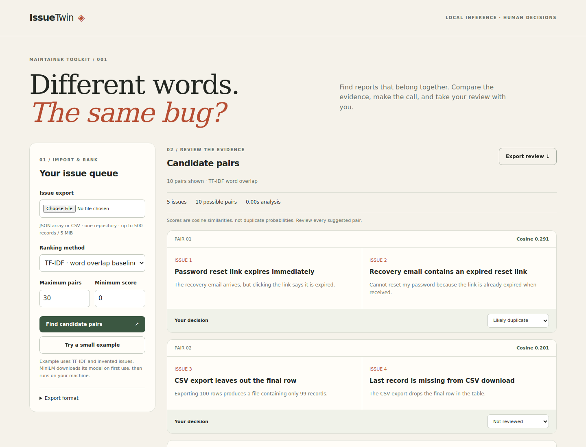

# IssueTwin

**Different words. The same bug?** A local-first tool for maintainers reviewing potentially duplicated GitHub issues. Import an export, compare reports side by side, record your decision, and download the review. Nothing automatically closes or modifies an issue.

## Quick start

Python **3.11 or 3.12 recommended**. No API key, GPU, account or paid service required.

```bash
git clone --branch feat/issuetwin-mvp https://github.com/oshada28nilendra-debug/issuetwin.git
cd issuetwin
python -m venv .venv
# macOS / Linux
source .venv/bin/activate
# Windows PowerShell instead: .venv\Scripts\Activate.ps1
python -m pip install -r requirements.txt
python -m pip install -e ".[dev]"
issuetwin serve
```

Open **http://127.0.0.1:8765**. Click **Try a small example** to use TF-IDF without a model download. To use semantic similarity, import `examples/issues.json` or `examples/issues.csv` and select **MiniLM**. It downloads approximately 90 MB of public model weights on first use. You can prefetch them with `issuetwin download`.

Model inference runs locally. Issue text is never sent to an inference API. Initial model acquisition contacts Hugging Face. Set `ISSUETWIN_OFFLINE=1` after downloading to require cached assets. A missing model produces an explicit error, never a silently substituted algorithm.



## Features

- Strict UTF-8 JSON/CSV import with helpful errors, duplicate-ID detection and GitHub pull-request exclusion.
- MiniLM sentence embeddings or a corpus-fitted TF-IDF baseline using title + body.
- Ranked, unique unordered candidate pairs; deterministic tie ordering; minimum-score and result-count controls.
- Side-by-side issue text, original links, human decisions (likely duplicate / different / needs investigation), downloadable JSON review with model revision and input hash.
- CLI ranking and exhaustive labelled pair evaluation, tests and CI.

## Import format

Import **one repository at a time**. JSON must be an array, such as GitHub's issues REST response or `gh issue list --json number,title,body,url` output. When available, `number` takes precedence over the global `id`. JSON records with non-null `pull_request` metadata are excluded; CSV rows with a nonblank `pull_request` marker are excluded. Blank/null markers keep normal issues. REST pagination must be collected by the exporter; IssueTwin does not fetch additional pages.

```json
[
  {"number": 12, "title": "Reset link expired", "body": "Steps to reproduce..."},
  {"number": 48, "title": "Recovery token invalid", "body": "What happened..."}
]
```

CSV requires `id` or `number`, and `title`. Optional columns: `body`, `url` or `html_url`. Quote commas and multiline fields. IDs must be unique; titles non-empty. Null JSON bodies become empty strings. Fields are rendered as plain text, not executable HTML/Markdown.

Limits: **5 MiB**, **500 input records**, **20,000 title/body characters per issue**, **100-character IDs**. All records are validated before scoring. The UI displays up to 1,000 pairs; the evaluation command uses every unordered pair. Pairwise ranking is O(n²), intentionally suitable for small queues.

## CLI

```bash
issuetwin rank examples/issues.csv --method minilm --top-k 20 --output reports/ranking.json
issuetwin rank examples/issues.json --method tfidf --min-score 0.1
issuetwin evaluate examples/issues.json examples/labels.json --k 10 --threshold 0.7 \
  --dataset-note "Authored synthetic fixture; not a real-world benchmark" \
  --output reports/evaluation.json
```

Labels are a JSON array with `left_id`, `right_id`, and a **boolean** `duplicate` field. Every unordered pair must be labelled exactly once. Unlabelled pairs are never silently treated as negative. Use `--methods tfidf` for an evaluation without model assets. Scores are cosine similarities in [-1, 1], **not probabilities**, and thresholds are not interchangeable between methods.

## Measured comparison

Run on 2026-10-11 using **24 authored fictional issues**, including 10 positive duplicate pairs and 4 related-but-different reports: 276 pairs in total. Labels were not used to train or tune either method. Full provenance, versions, scores, timing and checksums: [evaluation report](reports/synthetic-evaluation.json). Dataset details: [examples](examples/README.md).

| Method | Average precision | Precision@10 | Recall@10 |
|---|---:|---:|---:|
| MiniLM ONNX | 0.891 | 0.80 | 0.80 |
| TF-IDF | 0.531 | 0.60 | 0.60 |

This is a **smoke benchmark, not a real-world accuracy claim**. It is small, clean, English-only and author-biased. Related symptoms may have different root causes. MiniLM still puts two false positives in its top ten. At the illustrative 0.7 threshold it finds only 6/10 true duplicates, with one false positive. TF-IDF finds none at that same threshold; this does not mean an independently calibrated TF-IDF threshold cannot work. A representative, independently labelled issue dataset and separate development/test splits are needed for deployment decisions.

AP uses scikit-learn's threshold-grouped average precision. Top-k ties use lexicographic issue IDs (e.g. "10" before "2"). Precision uses the number actually returned when fewer than k pairs exist. Undefined recall/AP (no positive labels) is exported as null. Timings include model loading; they are not steady-state throughput measurements.

## Architecture and trade-offs

`core.py` validates exports, fits TF-IDF, normalizes vectors, ranks pairs and evaluates labels. `model.py` loads pinned ONNX assets, tokenizes in batches of 16, applies attention-mask mean pooling and L2 normalization. `service.py` adds provenance and warning metadata. `web.py` provides the local transport; vanilla browser code renders text and collects decisions. `cli.py` exposes the same engine for scripts and evaluation.

The pinned model is [`sentence-transformers/all-MiniLM-L6-v2`](https://huggingface.co/sentence-transformers/all-MiniLM-L6-v2), revision `1110a243fdf4706b3f48f1d95db1a4f5529b4d41`, using `onnx/model.onnx` and `tokenizer.json`. Embeddings have 384 dimensions. Inputs beyond **256 wordpiece tokens** are truncated; affected IDs are included in report metadata and the UI shows a warning. TF-IDF uses the full validated text, word unigrams/bigrams, sublinear term frequency and at most 20,000 features. This difference matters for long reports.

Why no database? One export → one review is useful without account or infrastructure setup. Decisions stay in browser memory and are cleared by rerunning or refreshing: **export before leaving**. Downloaded reports include original issue text; treat them as sensitive when your input is sensitive. The server binds only to localhost, rejects cross-origin analysis and untrusted hosts, bounds input, and sends no-store/CSP headers. This is a local single-user development server, not a hardened hosted multi-user service.

## Tests

```bash
python -m pytest -q -m "not model"  # no model download needed
issuetwin download
python -m pytest -q                # includes real MiniLM integration
```

Optional browser verification (Node.js 22+):

```bash
npm ci
npx playwright install chromium
# Run issuetwin serve in another terminal, then:
npm run test:browser
```

The browser script checks demo ranking, review JSON download, real CSV/MiniLM upload, reset behavior, imported HTML rendered as text, malformed uploads and 390px mobile overflow. CI runs core checks on Python 3.11/3.12 and real-model/browser checks on Python 3.12; status must be checked on the PR rather than inferred from this configuration.

## What this demonstrates

A useful AI feature includes more than model inference: trustworthy import validation, reproducible model selection, a meaningful baseline, honest evaluation, UI safety and a human decision step. In an interview, explain why a lexical baseline is necessary, how truncation changes recall, why a similarity threshold is not a probability, and why synthetic evaluation cannot prove adoption or field accuracy.

## References

- [MiniLM model card and mean-pooling example](https://huggingface.co/sentence-transformers/all-MiniLM-L6-v2)
- [ONNX Runtime Python inference](https://onnxruntime.ai/docs/get-started/with-python.html)
- [TF-IDF vectorizer](https://scikit-learn.org/stable/modules/generated/sklearn.feature_extraction.text.TfidfVectorizer.html)
- [Average precision definition](https://scikit-learn.org/stable/modules/generated/sklearn.metrics.average_precision_score.html)

The pretrained model has its own Apache-2.0 license. Synthetic example data was authored for this repository. No third-party issue reports are redistributed.
